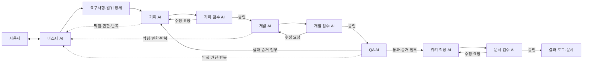

# AI 에이전트 워크플로 분석 및 실무 적용 가이드

> 원본: [현 시점 가장 꺼드럭 거릴 수 있는, "AI 활용의 정점"을 보여드리겠습니다](https://youtu.be/woSiT_kytXo)  
> 채널: 우주초월 · 길이: 52분 39초  
> 분석 기준: 한국어 자동 생성 자막. 고유명사와 일부 수치는 오인식 가능성이 있다.

## 1. 한눈에 보는 결론

이 영상의 핵심은 **AI에게 코딩을 시키는 방법**이 아니라, 사람이 하던 개발 조직의 역할과 검증 절차를 **여러 AI 역할로 분리하고 하나의 마스터 AI가 조율하게 만드는 방법**이다.

핵심 구조는 다음과 같다.



실무적으로 가장 가치 있는 메시지는 다섯 가지다.

1. 사람은 세부 작업자가 아니라 **요구사항과 판단 기준을 제공하는 감독자**가 된다.
2. 작성자와 검수자를 분리하고, 검수자는 직접 수정하지 않는 **읽기 전용 역할**로 둔다.
3. “완료했습니다”라는 말 대신 테스트 결과, 파일, 캡처 등 **완료 근거**를 요구한다.
4. QA 실패 시 개발만 고치는 것이 아니라 필요하면 기획 단계까지 되돌아간다.
5. 자동화가 깊어질수록 성능보다 **비용, 권한, 로그, 중단 조건**이 중요해진다.

---

## 2. 영상의 주요 주장

### 2.1 AI가 개발자를 없애기보다 개발 가능한 시장을 넓힌다

발표자는 AI를 과거의 게임 엔진과 클라우드에 비유한다. 유니티·언리얼이 등장해 게임 제작 비용이 낮아졌지만 개발자가 사라지지 않았고, AWS 같은 클라우드가 서버 운영 진입 장벽을 낮추면서 더 많은 서비스가 생겼다는 논리다.

이에 따라 다음 현상을 예상한다.

- 비개발자의 시제품 제작이 늘어난다.
- 시제품이 실제 서비스로 발전하면서 설계·운영·보안·장애 대응 능력이 필요해진다.
- 결과적으로 숙련 개발자의 역할은 단순 구현보다 구조 설계와 책임 있는 검증으로 이동한다.

이 부분은 설득력 있는 비유지만 미래 수요를 입증하는 통계 분석은 아니다. 경기, 금리, 투자 환경에 관한 발언도 발표자의 해석으로 봐야 한다.

### 2.2 개인 역량과 AI 활용 능력은 더해지는 것이 아니라 곱해진다

영상 후반의 요지는 다음 식으로 정리할 수 있다.

```text
산출 가치 ≈ 도메인·이론·현장 역량 × AI 활용 능력
```

- 기반 지식이 낮으면 AI를 능숙하게 사용해도 결과를 평가하거나 확장하기 어렵다.
- 기반 지식이 높아도 AI 활용 능력이 낮으면 생산성 향상을 충분히 얻지 못한다.
- 경력자가 AI를 조금만 익혀도 큰 효과를 내는 이유는 기존 지식과 경험이 증폭되기 때문이다.

따라서 프롬프트 기술만 익히기보다 이론, 실제 구현 경험, 결과 판별 능력을 함께 쌓으라는 주장이다.

### 2.3 현재의 핵심은 단일 프롬프트가 아니라 워크플로 설계다

영상은 AI 활용의 발전 단계를 대략 다음처럼 본다.

```text
단일 프롬프트 → 컨텍스트 관리 → 도구·하네스 → 역할과 흐름의 그래프 설계
```

마지막 단계에서는 AI 한 명에게 모든 일을 맡기지 않는다. 기획, 개발, QA, 문서화, 검수를 분리하고 조건에 따라 이전 단계로 되돌리거나 사람에게 권한을 요청하도록 설계한다.

---

## 3. 영상 속 워크플로 상세 해석

### 단계 1: 사용자와 마스터 AI가 요구사항을 확정한다

사용자는 마스터 AI와만 대화한다. 마스터는 구현 전에 질문을 반복해 모호한 부분을 해소하고 다음을 문서화한다.

- 달성할 목표
- 구현 범위
- 명시적으로 제외할 범위
- 제약 조건과 주의사항
- 성공·실패 판정 기준

큰 작업에서는 질의응답만 한 시간 이상 진행했다고 설명한다. 여기서 중요한 것은 빠른 착수가 아니라 **개발 전에 판단 기준을 고정하는 것**이다.

### 단계 2: 기획 AI가 실행 목록과 QA 목록을 만든다

기획 AI는 명세를 실행 가능한 작업으로 나눈다.

- 개발 할 일 목록
- 각 항목의 완료 조건
- 사람이 제품을 사용하는 것과 유사한 QA 시나리오
- 예외 입력과 공격적 테스트

별도의 검수 AI가 명세 누락과 충돌을 찾는다. 검수 결과가 승인될 때까지 기획 AI가 수정한다.

### 단계 3: 개발 AI가 한정된 목록만 구현한다

개발 AI는 확정된 할 일 목록을 하나씩 수행한다. 영상에서는 각 체크 항목에 반드시 완료 근거를 붙이게 한다.

좋은 완료 근거의 예:

- 변경된 파일과 핵심 동작
- 실행한 검사 명령과 결과
- 테스트 이름과 통과 결과
- 실제 생성된 산출물

나쁜 완료 근거의 예:

- “구현 완료”
- “문제없이 동작함”
- “요구사항을 모두 반영함”

후자는 확인 가능한 증거가 아니라 자기 보고에 불과하다.

### 단계 4: 다른 AI가 읽기 전용으로 검수한다

발표자는 주 작업 AI와 다른 계열의 모델을 검수자로 사용한다. 핵심은 특정 제품 조합이 아니라 다음 두 원칙이다.

1. 작성자와 다른 관점으로 결과를 본다.
2. 검수자는 직접 코드를 수정하지 않고 지적만 한다.

검수자가 직접 수정하면 코드의 방향과 스타일이 섞일 수 있다. 한 작업자가 일관되게 수정하고 검수자는 오류 탐지에 집중시키는 구조다.

### 단계 5: QA AI가 실제 사용 흐름을 검증한다

단위 테스트만으로 충분하지 않다고 보고, QA 역할이 실제 사용자의 행동을 재현한다.

- 버튼 클릭과 데이터 입력
- 새로고침과 반복 실행
- 잘못된 값과 특수문자 입력
- 정상 흐름과 예외 흐름
- 최종 화면 또는 결과 캡처

QA가 실패하면 개발 또는 기획 단계로 돌아간다. 통과하면 캡처와 로그를 근거로 남긴다.

### 단계 6: 최소한의 위키를 갱신한다

문서는 코드 전체를 다시 설명하지 않는다. 다음 작업에서 AI와 사람이 빠르게 큰 그림을 파악할 정도만 남긴다.

- 시스템 아키텍처
- 주요 정책과 결정
- 구성 요소 간 흐름
- 작업 시 반드시 지켜야 할 제약
- 관련 문서 인덱스

발표자는 마크다운 위키를 사용하며, 지나치게 상세한 문서나 복잡한 검색 시스템은 과할 수 있다고 본다.

### 단계 7: 모든 과정에 감사 가능한 로그를 남긴다

저장 대상은 다음과 같다.

- 사용자와 마스터 AI의 대화
- 확정 명세
- 기획안과 리뷰 내역
- 개발 체크리스트와 완료 근거
- QA 캡처와 결과
- 정제된 요약 로그
- 필요할 때 확인할 수 있는 원본 대화

로그는 단순 보관물이 아니다. 마스터 AI가 “어디서 오류가 났고 왜 재작업했는가”를 답하고, 이후 워크플로 자체를 개선하는 재료가 된다.

---

## 4. 설계 원칙으로 추출한 것

| 원칙 | 의미 | 적용 방법 |
|---|---|---|
| 명세 우선 | 모호함을 구현 단계로 넘기지 않는다 | 목표·제외 범위·판정 기준을 먼저 고정 |
| 역할 분리 | 생성과 평가는 다른 역할에 맡긴다 | 작업자와 읽기 전용 검수자 분리 |
| 증거 기반 완료 | AI의 자기 보고를 신뢰하지 않는다 | 테스트·파일·캡처·로그 요구 |
| 단계별 승인 | 오류가 다음 단계로 퍼지는 것을 막는다 | 승인 전에는 다음 단계 금지 |
| 실패 시 역행 | 증상이 아니라 원인이 생긴 단계로 돌아간다 | QA 실패 시 기획까지 재검토 가능 |
| 사람에게 에스컬레이션 | 권한·의사결정·반복 오류는 자동화하지 않는다 | 명시된 조건에서 마스터 또는 사용자 호출 |
| 편집권 단일화 | 여러 모델이 같은 결과물을 뒤섞지 않는다 | 한 모델이 수정, 다른 모델은 의견만 제시 |
| 최소 문서화 | 코드와 중복되는 설명을 쌓지 않는다 | 구조·정책·결정만 위키에 기록 |
| 비용 인식 | 에이전트 수가 늘면 비용도 급증한다 | 단계별 모델 선택, 한도, 캐시 활용 |
| 독립 작업만 병렬화 | 병렬화 이후 충돌 검증이 필요하다 | 의존성이 없는 작업만 분리 후 통합 검수 |

---

## 5. 내 작업에 적용할 최소 버전

영상처럼 처음부터 많은 에이전트와 이벤트를 만들 필요는 없다. 아래 네 역할이면 핵심 효과를 검증할 수 있다.

```text
나 ↔ 마스터
     ├─ 작업자: 계획하고 실행
     ├─ 검수자: 읽기 전용 검토
     └─ 검증자: 테스트하고 증거 수집
```

### 권장 폴더 구조

```text
work/
├─ request.md       # 목표, 범위, 제외 범위, 성공 기준
├─ todo.md          # 작업 항목과 완료 근거
├─ review.md        # 검수 지적과 승인 여부
├─ qa.md            # 테스트 시나리오와 결과
├─ evidence/        # 캡처와 산출물
└─ wiki.md          # 구조, 정책, 중요한 결정만 기록
```

### 상태 흐름

```text
DRAFT → PLANNED → IMPLEMENTED → REVIEWED → VERIFIED → DOCUMENTED → DONE
                    ↑      │          │
                    └──────┴─ 실패 ───┘
```

### 중단 및 사람 호출 조건

다음 중 하나면 자동 진행을 멈춘다.

- 같은 지적이 3회 반복됨
- 요구사항끼리 충돌함
- 외부 시스템 접근 또는 추가 권한이 필요함
- 데이터 삭제, 공개 게시, 결제 등 되돌리기 어려운 행동이 필요함
- 예상 비용이나 실행 시간이 정한 한도를 넘음
- 완료 근거를 만들 수 없음

---

## 6. 바로 복사해서 쓰는 작업 명세 템플릿

```markdown
# 작업 요청

## 목표
- 최종적으로 달성해야 할 결과:

## 사용자와 사용 상황
- 누가 사용하는가:
- 어떤 상황에서 사용하는가:

## 입력과 출력
- 입력:
- 출력:

## 포함 범위
-

## 제외 범위
-

## 제약 조건
- 변경 가능한 영역:
- 변경하면 안 되는 영역:
- 보안·개인정보 조건:
- 시간·비용 한도:

## 성공 기준
- [ ] 핵심 정상 흐름이 동작한다.
- [ ] 대표적인 실패 흐름이 안전하게 처리된다.
- [ ] 검사 결과와 산출물이 완료 근거로 남는다.
- [ ] 검수자의 미해결 지적이 없다.

## 사람에게 확인할 조건
- 요구사항 충돌
- 외부 권한 필요
- 데이터 손실 가능성
- 동일 실패 3회 반복
```

## 7. 역할별 지시문 템플릿

### 마스터 AI

```text
너는 작업 전체를 조율한다.
먼저 목표, 포함 범위, 제외 범위, 제약, 성공 기준의 모호함을 질문으로 해소하라.
명세가 확정되기 전에는 구현을 시작하지 마라.
기획, 실행, 검수, QA, 문서화를 순서대로 위임하고 각 단계의 승인과 증거를 확인하라.
같은 문제가 3회 반복되거나 권한·비용·되돌리기 어려운 행동이 필요하면 사용자에게 보고하고 멈춰라.
```

### 작업자 AI

```text
확정된 명세와 할 일 목록만 기준으로 작업하라.
범위를 임의로 넓히지 마라.
각 항목을 완료할 때 변경 내용과 확인 가능한 근거를 함께 기록하라.
근거가 없으면 완료로 표시하지 마라.
```

### 검수자 AI

```text
읽기 전용 검수자다. 결과물을 직접 수정하지 마라.
명세 위반, 누락, 오류, 보안·데이터 손실 위험만 지적하라.
각 지적에 위치, 영향, 재현 또는 확인 방법을 포함하라.
문제가 없으면 APPROVED, 있으면 CHANGES_REQUESTED로 끝내라.
취향 차이와 범위 밖 개선 제안은 승인 차단 사유로 삼지 마라.
```

### QA AI

```text
성공 기준에서 검증 시나리오를 만들고 실제로 실행하라.
정상 흐름, 대표 실패 흐름, 경계값을 확인하라.
각 결과를 PASS, FAIL, BLOCKED 중 하나로 기록하고 로그·캡처·산출물 등 근거를 첨부하라.
FAIL이면 원인이 생긴 단계와 재작업 항목을 제안하라.
BLOCKED이면 필요한 권한이나 환경을 구체적으로 보고하라.
```

---

## 8. 비용을 통제하는 방법

영상에서 가장 현실적인 제약으로 강조하는 부분이다.

- 모든 단계에 최고 성능 모델을 사용하지 않는다.
- 단순 문서 정리와 형식 검사는 저비용 모델에 맡긴다.
- 어려운 설계, 코드 변경, 최종 검수에만 고성능 모델을 쓴다.
- 공통 프로젝트 맥락을 한 번 읽힌 뒤 역할별 세션으로 분기해 캐시를 활용한다.
- 역할마다 필요한 문서만 제공해 컨텍스트를 줄인다.
- 승인 반복 횟수와 총비용 상한을 정한다.
- 병렬 실행은 시간은 줄여도 사용량은 늘릴 수 있음을 고려한다.

영상에서 언급된 캐시 적중률과 절감 체감은 통제 실험 결과가 아니라 발표자의 경험담이다. 실제 도입 전에는 같은 작업을 단일 에이전트 방식과 비교해 비용·시간·오류율을 직접 측정해야 한다.

### 최소 측정표

| 지표 | 기존 방식 | 에이전트 방식 |
|---|---:|---:|
| 완료 시간 |  |  |
| 사람 개입 시간 |  |  |
| 모델 사용 비용 |  |  |
| 검수에서 발견된 오류 |  |  |
| QA 실패 횟수 |  |  |
| 재작업 횟수 |  |  |

---

## 9. 비판적으로 봐야 할 부분

### 검증되지 않은 전망과 체감 수치

AI 시장, 경제, AGI 도달 시점, 개발자 수요에 관한 설명은 발표자의 견해가 강하다. 영상만으로 사실로 확정하면 안 된다. 또한 서로 다른 모델을 쓰면 검수가 더 잘된다는 주장과 세션 분기를 통한 비용 절감도 작업 유형별 실험이 필요하다.

### AI끼리 반복 검수해도 진실이 보장되지는 않는다

두 모델이 같은 잘못된 전제를 공유할 수 있다. 중요한 작업은 다음을 추가해야 한다.

- 독립적인 자동 테스트
- 실제 데이터 또는 공식 문서 대조
- 보안·법률·재무 등 고위험 영역의 사람 승인
- 운영 전 제한된 환경에서의 시험

### 무한 반복은 자동화가 아니라 비용 사고가 될 수 있다

영상은 승인까지 반복하는 구조를 보여주지만 실제 시스템에는 반드시 반복 상한, 비용 상한, 시간 제한이 필요하다. 같은 지적이 반복될 때는 계속 실행하지 말고 요구사항 또는 구조 문제로 승격해야 한다.

### “그럴듯한 보고서” 자동 생성 사례는 따라 하면 안 된다

영상의 출장 신청서 사례는 무작위 키워드와 AI로 그럴듯한 사유를 만든다고 설명한다. 실제 사실과 다른 사유나 성과를 생성하면 허위 보고, 감사 실패, 조직 신뢰 훼손으로 이어질 수 있다. 자동화는 **사실인 일정·업무 기록을 정리하는 용도**로만 사용하고, 제출 전 작성자가 사실성을 확인해야 한다.

### 전사 자동화에는 조직의 정보 구조가 필요하다

회의 기록, 메신저, 결정 사항, 작업 로그가 연결돼야 AI가 맥락을 이어갈 수 있다는 지적은 타당하다. 다만 모든 정보를 한곳에 모으면 접근권한과 개인정보 위험도 커진다. 최소 권한, 보존 기간, 민감정보 분리 정책을 함께 설계해야 한다.

---

## 10. 추천 도입 순서

### 1주차: 한 가지 반복 작업만 선정

- 자주 발생하고 결과 판정이 쉬운 작업을 고른다.
- 현재 소요 시간과 오류율을 기록한다.
- `request.md`와 `todo.md`만 도입한다.

### 2주차: 읽기 전용 검수 추가

- 작업자와 검수자 역할을 분리한다.
- 검수자는 직접 수정하지 못하게 한다.
- 반복 지적과 불필요한 지적을 기록한다.

### 3주차: QA와 증거 추가

- 성공 기준에서 QA 시나리오를 만든다.
- PASS/FAIL/BLOCKED와 증거를 남긴다.
- 실패 시 어느 단계로 돌아갈지 정한다.

### 4주차: 비용과 효과 판단

- 기존 방식과 시간, 사람 개입, 비용, 오류를 비교한다.
- 효과가 입증된 단계만 유지한다.
- 독립적인 일이 충분히 많을 때만 병렬화를 추가한다.

---

## 11. 타임스탬프별 다시 보기

| 구간 | 내용 |
|---|---|
| 02:55–05:30 | AI 전환에 대한 관점과 조직 준비의 중요성 |
| 09:39–13:25 | 바이브 코딩 확산과 개발자 역할 변화 |
| 16:15–18:20 | 기획→개발→QA→위키 워크플로 개요 |
| 18:20–21:35 | 작업 AI와 읽기 전용 검수 AI 분리 |
| 21:37–24:06 | 승인 반복, 마스터 질의, 명세와 할 일 목록 |
| 24:06–27:24 | 개발·QA·증거·위키·실패 복귀 구조 |
| 28:20–31:44 | 대화·QA·원본 로그와 조직 정보 연결 |
| 31:46–34:44 | 완료 근거, 이벤트와 상태 설계 |
| 34:45–36:00 | 큰 작업의 병렬 분해와 통합 검수 |
| 36:03–42:14 | 비용 문제, 단계별 모델 선택, 세션 분기와 캐시 |
| 44:47–46:08 | 업무 구조화 능력과 개발 이론의 가치 |
| 46:24–48:44 | 반복 업무 자동화 사례와 주의점 |
| 50:45–52:34 | 개인 역량 × AI 활용 능력이라는 결론 |

---

## 12. 최종 실행 체크리스트

- [ ] 자동화할 작업 하나를 고른다.
- [ ] 목표와 제외 범위를 문서로 고정한다.
- [ ] 성공 기준을 관찰 가능한 문장으로 쓴다.
- [ ] 작업자와 읽기 전용 검수자를 분리한다.
- [ ] 모든 완료 항목에 증거를 요구한다.
- [ ] QA 실패 시 돌아갈 단계를 정한다.
- [ ] 권한 요청과 위험 행동은 사람에게 올린다.
- [ ] 반복·시간·비용 상한을 설정한다.
- [ ] 구조와 중요한 결정만 위키에 남긴다.
- [ ] 기존 방식 대비 실제 효과를 측정한다.

## 한 문장 요약

**AI 활용의 고점은 더 긴 프롬프트가 아니라, 명세·역할 분리·독립 검수·실행 증거·실패 복귀·비용 통제를 하나의 반복 가능한 업무 시스템으로 만드는 데 있다.**
